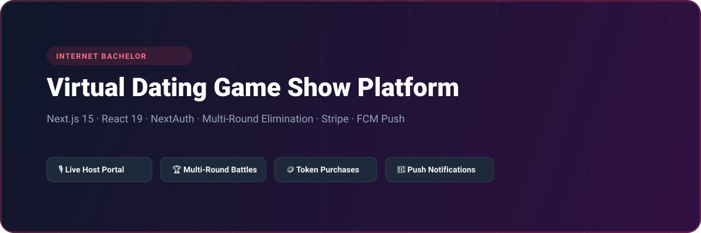
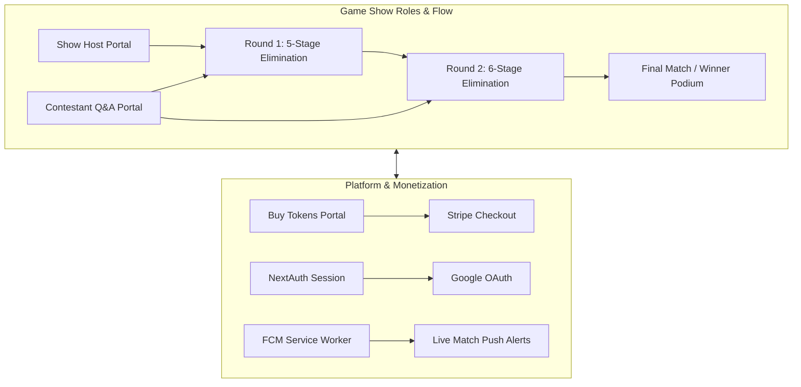

# Internet Bachelor - Virtual Dating Game Show & Elimination Web Platform

<p align="center">
  
</p>

<p align="center">
  <a href="https://nextjs.org"></a>
  <a href="https://react.dev"></a>
  <a href="https://next-auth.js.org"></a>
  <a href="https://stripe.com"></a>
  <a href="https://firebase.google.com"></a>
  <a href="https://tailwindcss.com"></a>
  <a href="LICENSE"></a>
</p>

---

## 📖 Overview

**Internet Bachelor Frontend (`ericjohnson_game_frontend`)** is an interactive live-format dating game show and virtual elimination platform built with Next.js 15 and React 19. Designed for engaging broadcast-style social interaction, the platform features dedicated host and contestant portals, multi-round elimination stages (Round One & Round Two with real-time progression), in-app token purchases via Stripe, direct messaging, and Firebase Cloud Messaging alerts.

---

## ⚡ Key Features

- **🎙️ Master Game Show Host Portal:** Control console allowing showrunners to advance rounds, initiate contestant questions, trigger elimination votes, and declare winners.
- **🏆 Multi-Stage Elimination Rounds:**
  - *Round One*: Rapid-fire introduction and initial cutdowns (Stages 1 through 5 and Final selection).
  - *Round Two*: In-depth compatibility trials and elimination playoffs (Stages 1 through 6 and Championship).
- **🪙 Token Economy & Stripe Checkout:** In-app virtual token bundles enabling viewers and contestants to unlock perks, vote, and participate in special challenges.
- **🔐 NextAuth Multi-Provider Authentication:** Seamless Google OAuth and credentials authentication with onboarding profile wizards.
- **🔔 Push Alerts & Notifications:** Integrated Firebase Cloud Messaging (FCM) background worker for live show invitations and game-start triggers.

---

## 🏗️ System Architecture



---

## 🗂️ Project Structure

```
ericjohnson_game_frontend/
├── assets/
│   └── banner.svg               # Architectural repository banner
├── public/
│   └── firebase-messaging-sw.js # FCM background service worker
├── src/
│   ├── app/
│   │   ├── (game)/              # Host console, Round 1 & Round 2 elimination routes
│   │   ├── (contestant)/        # Contestant response forms & ready room
│   │   ├── (default)/           # Game lobby, Buy tokens, Checkout, Chat
│   │   ├── (AuthLayout)/        # Login, Signup, Dating preferences
│   │   ├── api/auth/            # NextAuth API endpoints
│   │   └── layout.tsx
│   ├── components/              # Host control panels & contestant UI
│   ├── lib/                     # Firebase, NextAuth, and Stripe helpers
│   └── redux/                   # Redux Toolkit state slices
├── package.json
└── tsconfig.json
```

---

## 🛠️ Tech Stack

| Technology | Purpose |
| :--- | :--- |
| **Next.js 15** | Server and client rendering framework with App Router |
| **React 19** | Component architecture and UI state |
| **NextAuth.js** | Google OAuth and session authentication |
| **Stripe Checkout** | Token purchase payments |
| **Firebase FCM** | Real-time Web Push show reminders |
| **Tailwind CSS** | Neon game-show UI styling |
| **Radix UI** | Headless modal and interaction primitives |

---

## 🚀 Getting Started

### Prerequisites

- Node.js >= 20.0.0
- npm or yarn

### Installation

1. Clone the repository:
   ```bash
   git clone https://github.com/shahjalal-labs/ericjohnson_game_frontend.git
   cd ericjohnson_game_frontend
   ```

2. Install dependencies:
   ```bash
   npm install
   ```

3. Configure environment variables:
   ```bash
   cp .env.example .env.local
   ```

4. Start development server:
   ```bash
   npm run dev
   ```
   Open [http://localhost:3000](http://localhost:3000) to view the portal.

---

## 📄 License

This project is licensed under the [ISC License](LICENSE).
